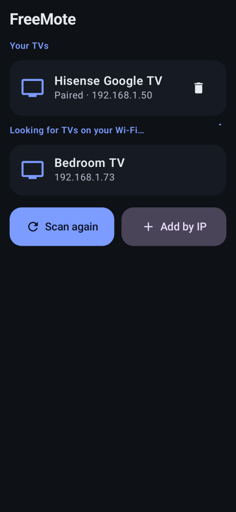
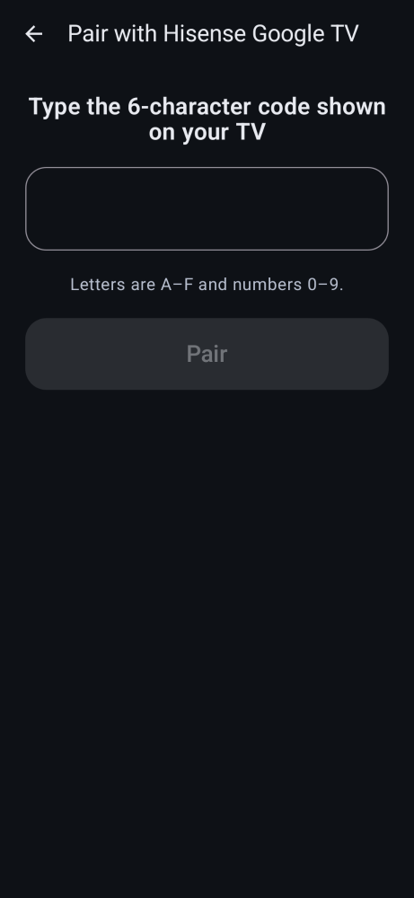
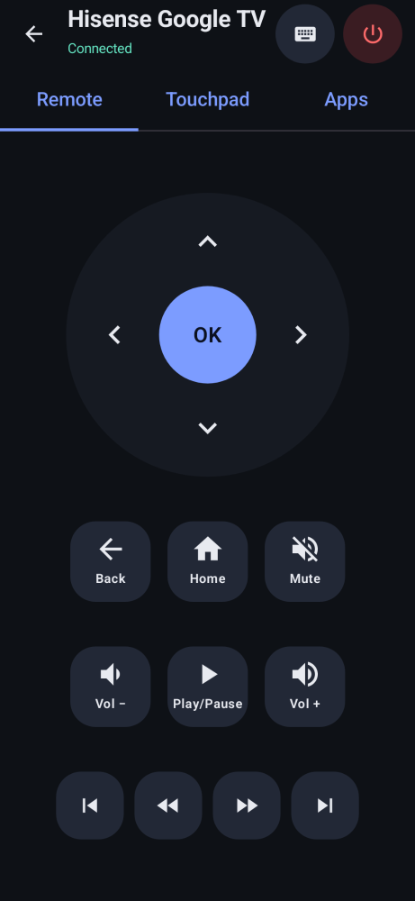
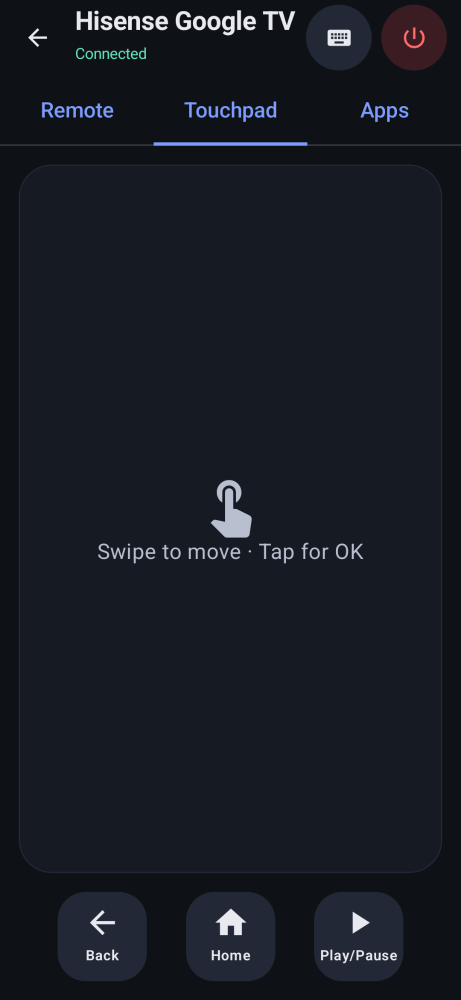
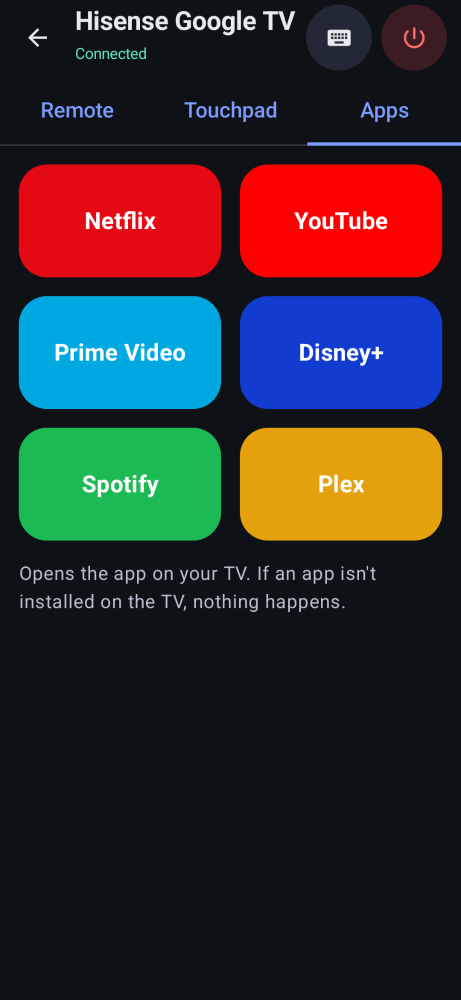

# FreeMote

**A free remote for Google TV and Android TV — on your Android phone.**
No account. No ads. No tracking. Open source (MIT).

## What it does
Big buttons for arrows, OK, Back, Home, volume, mute, power and play/pause.
A swipe touchpad, typing with your phone keyboard, and one-tap buttons for
Netflix, YouTube, Prime Video, Disney+, Spotify and Plex.

## How to install
1. On your phone, open the **[Releases page](https://github.com/thefridgeunpluggedwpg/freemote/releases/latest)**
   and tap **FreeMote.apk** to download it.
2. Open the downloaded file. If Android asks, **allow installs from your browser**, then go back and tap **Install**.
3. Open **FreeMote**.
4. Pick your TV from the list.
5. Your TV shows a **6-character code**. Type it into your phone and tap **Pair**. You only do this once.

## Troubleshooting
- **TV not in the list?** Make sure your phone and TV are on the **same Wi-Fi**. Tap **Scan again**.
- **Still not found?** Restart the TV (unplug it for 10 seconds), then scan again.
- **Add it by hand:** on the TV go to **Settings > Network & Internet**, tap your Wi-Fi and note the
  **IP address** (like `192.168.1.50`). In FreeMote tap **Add by IP** and type it.
- **"Needs pairing"?** Tap **Pair** and type the new code from the TV.
- **Typing doesn't show up?** Select the search box on the TV first. If it still doesn't work,
  tick **Type letter by letter** in the keyboard window.

## Credits
FreeMote speaks the same Android TV Remote v2 protocol as Google's own remote. It would not
exist without these projects:
- [androidtvremote2](https://github.com/tronikos/androidtvremote2) by tronikos (Apache-2.0) —
  protocol files and the pairing/remote logic FreeMote's code is ported from.
- [androidtv-remote](https://github.com/louis49/androidtv-remote) by louis49 (MIT) — original `remotemessage.proto`.
- Google's [polo pairing protocol](https://android.googlesource.com/platform/external/google-tv-pairing-protocol/) (Apache-2.0).

See [NOTICE](NOTICE) for details. FreeMote is not affiliated with Google.

For developers: see [AGENTS.md](AGENTS.md) and [docs/](docs/spec.md).
